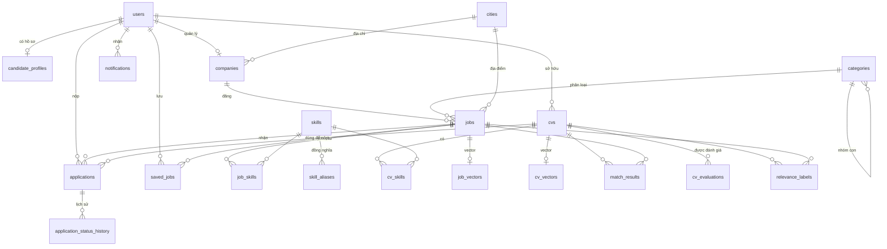

# Cơ sở dữ liệu KhớpViệc

MySQL 8.0, database `recruitment`, charset `utf8mb4_unicode_ci`. Gồm 20 bảng, 2 view và 1 event.

| File | Nội dung |
|---|---|
| [schema.sql](schema.sql) | Tạo database, bảng, khóa, chỉ mục, view, event. **Chạy lại sẽ xóa toàn bộ dữ liệu cũ.** |
| [seed.sql](seed.sql) | Dữ liệu mẫu: 34 tỉnh thành, 29 ngành/nhóm nghề, 90 kỹ năng + từ đồng nghĩa, 18 tài khoản, 14 công ty, 32 tin tuyển dụng, 3 CV, 5 hồ sơ ứng tuyển |

## Cài đặt

```bash
mysql -u root -p < database/schema.sql
mysql -u root -p recruitment < database/seed.sql
```

Hoặc trong MySQL Workbench: File → Open SQL Script → chọn `schema.sql` → Execute, rồi làm tương tự với `seed.sql`.

Tạo tài khoản riêng cho backend (khuyến nghị, không dùng root):

```sql
CREATE USER 'recruitment_app'@'localhost' IDENTIFIED BY 'doi-mat-khau-nay';
GRANT SELECT, INSERT, UPDATE, DELETE ON recruitment.* TO 'recruitment_app'@'localhost';
```

### Tài khoản demo (mật khẩu chung: `Matkhau@123`)

| Vai trò | Email | Ghi chú |
|---|---|---|
| Quản trị viên | `admin@khopviec.vn` | |
| Nhà tuyển dụng | `tuyendung01@khopviec.vn` … `tuyendung13@khopviec.vn` | Mỗi tài khoản quản lý 1 công ty, ví dụ `tuyendung01` là Công ty CP Công nghệ Sao Mai |
| Nhà tuyển dụng chờ duyệt | `tuyendung14@khopviec.vn` | Công ty TNHH Giải pháp Xanh, để demo chức năng duyệt tài khoản |
| Ứng viên | `an.nguyen@khopviec.vn` | Frontend, CV tốt, có 3 hồ sơ ứng tuyển (đang phỏng vấn, đã nộp, bị từ chối) |
| Ứng viên | `binh.tran@khopviec.vn` | Kế toán |
| Ứng viên | `chau.le@khopviec.vn` | Marketing, CV **cố ý viết chung chung** để demo chức năng gợi ý sửa CV |

## Sơ đồ quan hệ



## Các bảng

### Danh mục dùng chung
| Bảng | Vai trò |
|---|---|
| `cities` | 34 tỉnh/thành sau sắp xếp đơn vị hành chính 07/2025. Dùng cho bộ lọc và tiêu chí địa điểm khi tính điểm. |
| `categories` | 2 cấp: ngành nghề (`parent_id` NULL) và nhóm công việc. Tin tuyển dụng gắn với nhóm công việc (cấp 2). |
| `skills` | Từ điển kỹ năng chuẩn. Admin tắt (`is_active`) thay vì xóa khi kỹ năng đã được dùng. |
| `skill_aliases` | Từ đồng nghĩa viết thường: `reactjs`, `react.js` → React. Là bước chuẩn hóa trước thuật toán 1. |
| `app_settings` | Cấu hình dạng JSON: trọng số điểm, model embedding, quy tắc đánh giá CV. Admin chỉnh được khi làm thực nghiệm. |

### Tài khoản
| Bảng | Vai trò |
|---|---|
| `users` | Tài khoản chung cho 3 vai trò (`role`). Nhà tuyển dụng mới ở trạng thái `pending` tới khi admin duyệt; admin khóa tài khoản bằng `locked`. |
| `candidate_profiles` | Hồ sơ ứng viên, quan hệ 1–1 với `users`. Kinh nghiệm, học vấn, địa điểm được dùng để tính điểm tiêu chí. |
| `companies` | Thông tin công ty, mỗi tài khoản nhà tuyển dụng quản lý 1 công ty. |

### Tin tuyển dụng
| Bảng | Vai trò |
|---|---|
| `jobs` | Tin tuyển dụng. Vòng đời: `draft` → `pending` (chờ duyệt) → `approved` / `rejected`; `closed` khi nhà tuyển dụng đóng hoặc quá hạn. Có FULLTEXT (parser ngram) cho tìm kiếm tiếng Việt. |
| `job_skills` | Kỹ năng yêu cầu, phân biệt **bắt buộc** (trọng số 2) và **ưu tiên** (trọng số 1). |
| `job_vectors` | Văn bản đã tách từ (đầu vào TF-IDF) và embedding Sentence-BERT, tính sẵn khi tin được duyệt. |

### CV
| Bảng | Vai trò |
|---|---|
| `cvs` | CV tải lên (`upload`, giữ file gốc + văn bản trích xuất) hoặc tạo bằng form (`builder`). Nội dung có cấu trúc lưu ở cột `content` (JSON). Xóa mềm bằng `deleted_at` vì CV đã nộp vẫn phải giữ cho nhà tuyển dụng. |
| `cv_skills` | Kỹ năng đọc được từ CV (`parsed`) hoặc ứng viên tự thêm (`manual`). |
| `cv_vectors` | Như `job_vectors`, cho CV. |
| `cv_evaluations` | Kết quả chức năng 3: điểm CV và danh sách vấn đề kèm gợi ý sửa, có thể theo một job cụ thể. |

### So khớp
| Bảng | Vai trò |
|---|---|
| `match_results` | Cache điểm CV–job: điểm tổng và điểm của từng thuật toán, kỹ năng khớp/thiếu. Dùng cho Top 10 (đọc theo `cv_id`) và xếp hạng ứng viên (đọc theo `job_id`). |
| `relevance_labels` | Nhãn phù hợp gán tay (0/1/2) cho cặp CV–job, dùng tính Precision@10 và NDCG@10 trong chương thực nghiệm. |

### Ứng tuyển
| Bảng | Vai trò |
|---|---|
| `applications` | Hồ sơ ứng tuyển, mỗi ứng viên nộp 1 lần cho 1 tin. Lưu điểm phù hợp lúc nộp để nhà tuyển dụng xếp hạng. |
| `application_status_history` | Mỗi lần đổi trạng thái thêm 1 dòng, để ứng viên xem tiến trình. |
| `saved_jobs` | Việc làm ứng viên đã lưu. |
| `notifications` | Thông báo: đổi trạng thái hồ sơ, có hồ sơ mới, tin được duyệt/bị từ chối, tài khoản được duyệt. |

### View và event
| Tên | Vai trò |
|---|---|
| `v_open_jobs` | Tin đang hiển thị công khai: `approved` và còn hạn. |
| `v_admin_stats` | Số liệu tổng cho trang thống kê admin. |
| `ev_close_expired_jobs` | Chạy mỗi giờ, chuyển tin quá hạn sang `closed`. |

## Quyết định thiết kế

- **Nội dung CV lưu JSON** (`cvs.content`) thay vì tách bảng kinh nghiệm, học vấn…: CV luôn được đọc và sửa nguyên khối trên form, không truy vấn riêng từng mục. Kỹ năng thì tách bảng `cv_skills` vì cần so khớp và thống kê.
- **Embedding lưu JSON**, cosine tính bằng numpy trong backend: MySQL Community không có hàm khoảng cách vector; với vài nghìn tin vẫn đủ nhanh.
- **Xóa mềm CV** (`deleted_at`) và `applications.cv_id ON DELETE RESTRICT`: không làm mất CV mà nhà tuyển dụng đang xem.
- **Kỹ năng `ON DELETE RESTRICT`** ở `job_skills`, `cv_skills`: không xóa được kỹ năng đang dùng, admin tắt `is_active` thay thế.
- **Tìm kiếm**: collation `utf8mb4_unicode_ci` không phân biệt dấu, nên gõ "ke toan" vẫn ra "Kế toán". Backend phải đặt từ khóa trong ngoặc kép khi dùng FULLTEXT (`AGAINST ('"kế toán"' IN BOOLEAN MODE)`); không có ngoặc kép, parser ngram tách thành từng cặp ký tự và khớp quá rộng.
- **Lương lưu theo triệu đồng** (`DECIMAL(6,1)`), `NULL` nghĩa là thỏa thuận.
- `job_vectors`, `cv_vectors`, `match_results` để trống trong dữ liệu mẫu: backend tự tính khi khởi động hoặc khi dữ liệu thay đổi.
